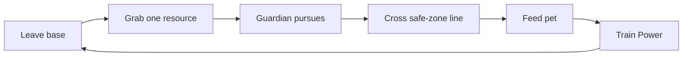

# Start Here

## What this project is

**Feed a Pet** is a compact Roblox game: steal one physical resource from a guarded field, escape the guardian, feed the pet at your base, and train Power so you can carry heavier loot farther. The repo folder is `Feed-a-Dino`, the Rojo project is still named `Feed a Dino`, and many modules say `Monster`. Those are leftovers, not the product name.

## Where the code stands

- Main tree: branch `phase3-phase4a-snapshot`, HEAD `86228f2`, with a large uncommitted working tree on top.
- Second worktree `Feed-a-Dino-phase3b`: branch `phase3b`, HEAD `44e6506`.
- Branch and tree state are re-checked in [[05 - Development/Current State and Roadmap]].

## How to use this vault

1. Do not read it in full. Open [[00 - Home/Task Router]] and take the one row that matches your task.
2. Open the source files in that row. **Current Luau source wins** over any note.
3. Open a note only for an invariant, a decision, or a visual that the source cannot give you.

## Sections

- Design intent: [[01 - Game Design/Game Vision and Core Loop]]
- Code and tests: [[02 - Engineering/Architecture and Module Map]]
- Look and feel: [[03 - Visual Design/Art Direction]]
- Status, bugs, decisions: [[05 - Development/Current State and Roadmap]]
- Procedure for agents: [[06 - Agent Workflows/Agent Playbook]]
- Steal an Egg research (reference only): [[04 - Reference Research/Steal an Egg Analysis]]

## Evidence labels

| Label | Meaning |
| --- | --- |
| VERIFIED IMPLEMENTATION | Seen in current source, a test, or an inspected Studio result |
| CONFIRMED DESIGN | In project docs or an owner decision, not necessarily built |
| REFERENCE OBSERVATION | Seen in Steal an Egg material under `references/`. Never a requirement |
| PROPOSAL | Suggested, not approved |
| UNKNOWN | Not checked or not determinable |

`last_verified` in a note's frontmatter appears only when its claims were checked against source on that date.

## Finding source

Rojo owns `src/shared`, `src/server`, `src/client`. Studio owns Workspace, models, and terrain. Do not guess instance paths: inspect them with Studio MCP.
