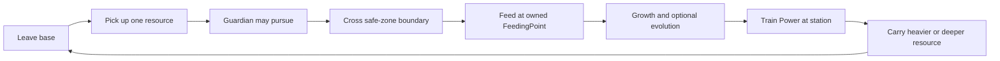

# Game Vision and Core Loop

## At a Glance

A short, socially visible risk path plus a deep pet. Acquisition stays simple. Depth lives in evolution, rarity, catalysts, and Power. Product name: **Feed a Pet**.

## Confirmed Design

Source: `docs/FEED_A_PET_MASTER_CONTEXT.md` v2.0 (2026-10-09). Status of each item is tracked in [[05 - Development/Current State and Roadmap]].

**Objective.** Run out, take one physical item, survive a guardian hazard, return, feed the active pet, evolve, train Power, then carry heavier and deeper loot.

**Primary loop.** Run out, grab item, escape, feed pet, evolve, get stronger, go farther.
**Supporting loop.** Better pet gives better training and income, which gives more Power, which allows heavier and deeper loot.

**Pillars.** One primary loop. One supporting loop. A narrow map (four bases, one long path, five launch areas). Guardians are hazards without HP. Server owns progression. Data over scripts. Graybox before art.

**Risk and reward.** Farther areas hold rarer, heavier resources and need a longer return run. A caught carrier drops the item (see [[01 - Game Design/Guardians and Carrying]]). A field reset can forfeit an item still inside the field (see [[01 - Game Design/Resources and Field Resets]]).

**Engagement mechanisms (design intent).** Visible distance, contested loot that other players can see, rare-spawn announcements, readable Power progression, and evolution choices. Only the rare announcement and the Power gate are built.

**Explicitly rejected.** Conveyor acquisition, expedition quests, combat enemies, research tablet, NPC selling as the core loop, material banking, weapons, lab-tycoon bases. A conveyor may return only as a scoped secondary convenience.

**Short vs long term.** Short term: one run, one feed, a Power gain. Long term: ten trainer tiers, stage 0 to 3 evolution, deeper areas. Stage 4 and 5 content is locked. Path length after five areas is an open question: [[05 - Development/Decisions and Open Questions]].

## First-session experience

CONFIRMED DESIGN, not implemented as guided onboarding: five short contextual objectives (grab some food, return to your pet, feed your pet, train Power, grab a heavier item), no tutorial wall. The playtest success condition in `docs/CURRENT_STATE.md` is: spawn, steal, survive the telegraph, feed, evolve once, train, then carry something impossible at Power 0. No guided objective UI exists in `src/client`. No fresh-human session has been recorded.

## Differentiation from Steal an Egg

REFERENCE OBSERVATION: Steal an Egg shares the steal, escape, and buy-speed shape. Feed a Pet differs by design: resources not eggs, a pet that evolves along branches rather than hatches, Power (not Speed) as the trained stat with speed derived, one linear runway, and five fixed guardians. See [[04 - Reference Research/Steal an Egg Analysis]]. Do not import its names, prices, or art.

## Current Implementation

VERIFIED IMPLEMENTATION: `GameBootstrap.server.luau` validates definitions, then starts the services. One carried resource per player. Starter pet `ProtoRex`; first evolution needs Growth 25 and a dominant affinity of 20 (`GrowthStageDefinitions`). The field runs a 300-second cycle with a 10-second reset window.

## Constraints and Invariants

- Server owns carry, feeding, evolution, Cash, Power, saves.
- No new systems without an explicit task.
- Player-facing word is **pet**. Do not rename `Monster*` ids in drive-by edits.

## Open Questions

Path length beyond five areas, PvP theft versus world-only, owned-pet count, event cadence. All in [[05 - Development/Decisions and Open Questions]].

## Related Notes and Source Files

[[01 - Game Design/Pets, Feeding and Evolution]], [[01 - Game Design/Progression and Economy]], `docs/FEED_A_PET_MASTER_CONTEXT.md`.
