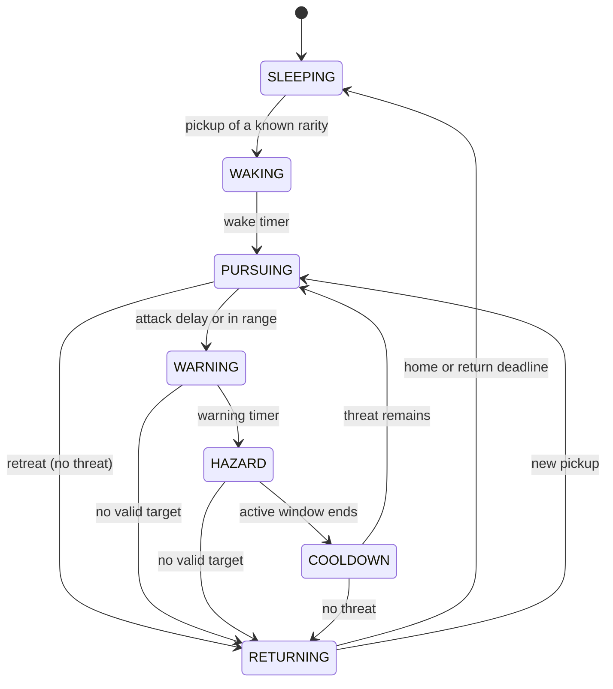

# Guardians and Carrying

## At a Glance

One guardian per launch area. Guardians are hazards with no HP. Stealing a resource wakes that area's guardian, which chases the carrier along the runway toward the safe-zone boundary. Carrying slows the player. A catch knocks the item loose. All numbers below are PROVISIONAL graybox tuning copied from Luau on 2026-10-21; **the Luau file wins**.

## Assignments

| Area | Guardian (`AreaDefinitions`) | Hazard `Kind` | `BaselineWalk` | Studio X of guardian |
| --- | --- | --- | ---: | ---: |
| Grasslands | T-Rex | Charge | 22 | 458 |
| Swamp | Giant Crocodile | Lunge | 24 | 777 |
| Jungle | Giant Gorilla | Shockwave | 27 | 1064 |
| CrystalCave | Armored Triceratops | Charge | 30 | 1351 |
| Volcano | Dragon | FireSweep | 35 | 1638 |

Studio positions were read from `Workspace.GeneratedGameplay.Guardians` in a live Play server (all at Z about -99). Other per-area values (`SpeedRatio` 1.07 to 1.14, `CatchUpRatio` 1.65 to 1.85, `EngageDistance` 30 to 38, `CatchReach` 5, `Wake` 0.6 to 0.65 s) are in `GuardianConfig.Areas`.

## State Machine

VERIFIED IMPLEMENTATION (`GuardianState.Transitions`, `State:step`).

**Wake condition.** `State:pickup` accepts any rarity with a `GuardianChase.Profiles` entry and wakes a sleeper at once. A pickup during WARNING, HAZARD, or COOLDOWN is acknowledged but does not queue a second attack. `GuardianConfig.Disturbance`, `Immediate`, and `Threshold` exist but I found no non-test reader in `src/`; older notes that described disturbance accumulation are stale (recorded in [[05 - Development/Bugs and Test Status]], D4).

**Target acquisition.** `GuardianService.remember` records each thief in `r.Threats` with rarity and token. The first thief is locked for `Chase.Timing.InitialLock`; afterwards `Chase.select` scores candidates (initial bonus, proximity, recent theft, attack commitment) and a replacement target switches only past `SwitchThreshold`. A guardian only pursues carriers of its own area's resources (ownership never transfers).

**Pursuit speed.** `Chase.speed = BaselineWalk * (1 - worstSlowdown) * ratio * rarityProfile.Speed`. `ratio` blends from `CatchUpRatio` (beyond `2 * EngageDistance`) to `SpeedRatio` (at `EngageDistance`). It never reads the player's WalkSpeed or Power. Rarity profiles run from 1.00 (Common) to 1.09 (Divine).

**Safe zone.** `Workspace.GeneratedGameplay.SafeZoneBoundary` is a generated part (read: X about 283, size 2 x 40 x 157). `Chase.isSafe(runway, position)` decides safety. Crossing it ends the dangerous return. `RETURNING` travel is faster than any pursuit (`Config.validate` asserts it).

**Catch and drop.** `catchCarriers` tests four short arcs per tick against the body box (`CatchReach`, `Catch.VerticalReach`). A hit calls `Carry.forceDrop` and `GuardianCatch.apply` (ragdoll 1.1 s, recovery 2.2 s, launch 34 horizontal and 26 vertical studs/s). Pickup is blocked until recovery ends. Overlapping guardians never telegraph on one player (`attackClear`, `CrowdRadius`).

## Carrying

**Guardian return policy (2026-10-23):** body catches and special-attack hits return
the carried feed to its record's original `SpawnPosition`, not the hit location.
The existing GUID and curse assignment are retained; it remains collectible through
the existing DROPPED lifecycle and expiry. Manual/death drops are unchanged. Field
reset forfeiture takes priority and cannot be undone by a simultaneous guardian hit.
Implementation: `CarryService.forceDrop(..., returnToSpawn)`; only GuardianService's
two hit paths opt in. Studio evidence: `docs/GUARDIAN_RETURN_RESULTS.json`.

- One carried resource. `CarryService` is server-owned state; clients send `DropCarried` (G key, gamepad B) and `SetSlowMode` (V key or button).
- Speed: `MovementConfig.Milestones` map Power to unloaded and carrying base speed (22/22 at Power 0 up to 72/52 at 150,000,000). Slow Mode uses `PrecisionSpeed` 16. The carry base is then reduced by the resource's `CarrySlowdown` plus curse slowdown, clamped by `CarryDebuff.MaxTotal` 0.62.
- Curses (`CarryDebuff.Profiles`): none for Common to Rare; Epic rolls a Mild curse at 0.25; Legendary and above always roll a primary; Eternal and Divine can add a secondary. Presentation is client-side in `CarryCursePresentation`.
- Studio-only test override `CarryService.setTestBaseOverride` is not saved ([[02 - Engineering/Security, Testing and Diagnostics]]).

## Invariants

- Do not scale pursuit from live WalkSpeed.
- Do not replace pursuit with a short-radius attack that skips the runway.
- A reset must not let a hazard callback recreate a cancelled sweep (fixed per the fast-heist report; `FastHeistReset` covers it).
- Server owns movement and collision; `GuardianPresentation` only renders.

## Tests

Unit: `GuardianState_Test`, `GuardianChase_Test`, `GuardianJourney_Test`, `GuardianGeometry_Test`, `CarryDebuff_Test`, `Movement_Test`. Opt-in Play: `tests/Phase3BRunway`, `Phase3BMultiplayer`, `FastHeistReset`, `FastHeistPhysics`. Results: [[05 - Development/Bugs and Test Status]].

## Reference Observation (Steal an Egg)

Guardians there are one oversized sleeping creature per biome; stills show startled poses ([[03 - Visual Design/Visual Reference Gallery]]). The four decoded clips contain **no chase footage**, so chase timing, speed, and target rules were not observed. Captions in `references/research/05_prompt_review.md` claim a first-grabber rule; that is unverified and not a Feed a Pet rule.

## Open Questions

Final difficulty: kinematic trials at current ratios were hostile and are not an approved target; human dodge rates are unknown ([[05 - Development/Decisions and Open Questions]]).
