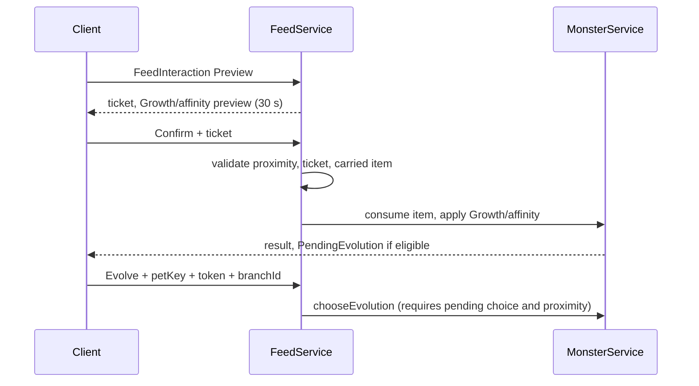

# Pets, Feeding and Evolution

## At a Glance

A player owns pets keyed by species id. The equipped pet is fed one carried resource at a time. Feeding adds Growth and one of three affinities (Flesh, Floral, Mineral). At a stage threshold the server offers evolution branches; the player picks one. Code ids still say `Monster`; the player-facing word is **pet**.

## Current Implementation

**VERIFIED IMPLEMENTATION** (2026-10-21).

**Pet record** (`PlayerData.normalize`): Species, Growth, TotalGrowth, Revision, Stage, EvolutionHistory, Flesh, Flora, Mineral, Mutations, Rarity, EvolutionFamilies; optional PetId, EvolutionForm, EvolutionVersion, GrowthReserve, Lineage, LineageTags, PendingEvolution, LatentTraits, SpecialEvolutions, Ascension, Awakened, Awakening, Qualifications. The saved affinity is `Flora`; UI may say Floral. `EquippedMonster` selects the active pet (default `ProtoRex`). Ownership is keyed by the original species id; `EvolutionForm` changes without moving the key. `PlayerData.default` creates one Common ProtoRex.

**Feeding.** `FeedService.preview` builds a ticket near the owned `FeedingPoint`; `confirm` consumes the carried resource and applies growth. Tickets expire after 30 s and are bound to the character. Requests are rate-limited (0.2 s via `InteractionGuard`). Growth overflows into `GrowthReserve`; one stage advances at a time.

**Stages** (`GrowthStageDefinitions`, `PROVISIONAL_BALANCE`):

| Stage | Label | `GrowthRequired` | Scale | Note |
| ---: | --- | ---: | ---: | --- |
| 0 | Starter | 25 | 1 | `AffinityRequired` 20 |
| 1 | Juvenile | 80 | 1.2 | |
| 2 | Mature | 160 | 1.4 | |
| 3 | Apex | 3000 | 1.6 | 3000 is illustrative |
| 4 | Ascended | 3000 | 1.8 | `Locked` storage cap |
| 5 | Mythic Ascension | 3000 | 2 | `Locked` |

`SpiritDragon` keeps a growth override of 200.

**ProtoRex branches.** Stage 0 becomes Fangling, Mossback, or Stonehide from affinity, or JuvenileRex as fallback. Stage 1 can fall back to MatureRex or meet provisional hybrid minima (80 and 80) for ArmoredRex (Flesh+Mineral), VenomRex (Flesh+Floral), or CrystalMossRex (Floral+Mineral). Family branches include PrimalRex, ToxicRex, AlphaRex, DraconicRex, InfernoRex (provisional; display names are placeholders). Stage 2 leads to ApexRex, then AscendedRex; AscendedRex to MythicRex is `Locked`. MagmaRex, CrystalWolf, SpiritDragon remain defined but are not the launch ladder. See `docs/LINEAGE_SYSTEM.md`.

**Catalysts.** Launch catalysts are resources with a family tag: Primal, Toxic, Beast, Crystal, Fire, Draconic, Inferno, plus the mutation-roll feed MutantLeech (`MutationRoll`). Family unlocks persist in `EvolutionFamilies`.

**Mutations** (`MutationDefinitions`): Silver, Golden, Rainbow are defined with `AcquisitionEnabled = false`; Mutant acquisition is enabled; Parasite is disabled. Family ids in that module are `Kind = "EvolutionFamily"`, `Enabled = false`. The live roll is 5% Mutant Leech (`FeedRolls`, `docs/CURRENT_STATE.md`).

**Multipliers.** `PetMultipliers.resolve` takes the larger of the form and species `IncomeMultiplier` / `TrainingMultiplier`, multiplies by rarity, stage, mutation, and awakening factors from `PetProgressionConfig.Multipliers`, then clamps to `Min`/`Max`.

**Rarity.** Pet rarity is separate from resource rarity. Branches use `RarityRule = "Keep"`; ordinary evolution does not change pet rarity.

**Locked.** `PetProgressionConfig` Ascension and Awakening have `Enabled = false` and `RequirementsApproved = false`.

## Server Validation

`Evolution.valid` requires the record stage to match the form's stage. `MonsterService.chooseEvolution` requires a pending choice and proximity. The client only sends action, pet key, token, and branch id. Feed confirm re-checks the ticket, character, carried item, and distance.

## UI Data Needs

The HUD reads attributes `MonsterId`, `MonsterName`, `PetStage`, `PetStageLabel`, `GrowthReserve`, `PendingEvolution`, `OwnedPetKey` (published by the server). Branch buttons are built from the pending choice. Contracts: [[03 - Visual Design/UI Screens and Contracts]].

## Visuals

Definitions set `Visual.ModelKey = "Placeholder"`. The live pet is a graybox at `CreatureSpawn`. Final models do not exist ([[03 - Visual Design/Creatures and Asset Specifications]]).

## Open Questions

Owned-pet count, final evolution UI, deterministic versus probabilistic special catalysts, approved Stage 5 requirements: [[05 - Development/Decisions and Open Questions]].

## Related Notes and Source Files

[[01 - Game Design/Rarity and Content Catalog]], [[01 - Game Design/Resources and Field Resets]], tests `EvolutionStages_Test`, `FeedingGrowth_Test`, `CatalystEffects_Test`, `PetPrestige_Test`.
