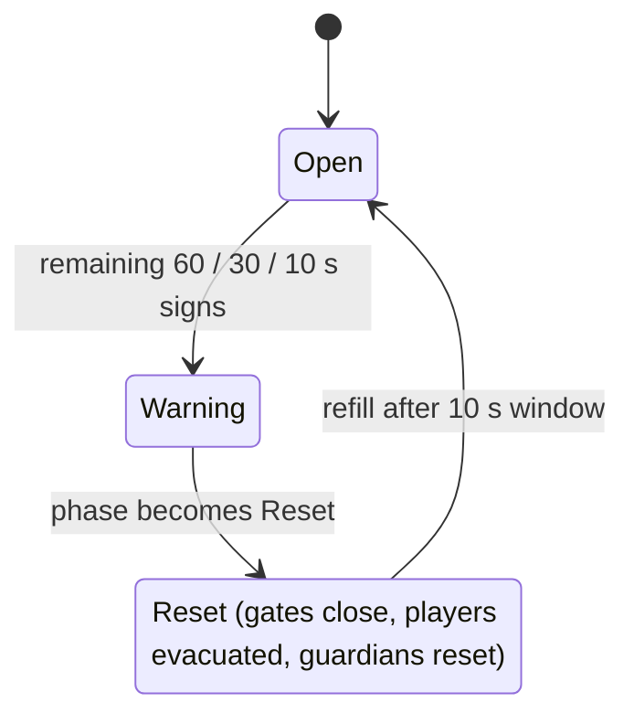

# Resources and Field Resets

## At a Glance

One server-wide field holds 25 physical nodes (5 per area, 5 areas). Each 300-second cycle ends in a 10-second reset. Players pick up one item at a time. Authority for exact resource rows is `docs/RESOURCE_SPECIFICATION.md` plus `ResourceDefinitions.add`. This note does not restate all 40 rows; the catalog is in [[01 - Game Design/Rarity and Content Catalog]].

## Current Implementation

**VERIFIED IMPLEMENTATION** (read 2026-10-21).

- **Categories.** `Feed` (Growth plus affinity) and `Catalyst` (carries a family tag such as Primal or Fire; it also has Growth and `Neutral` affinity values). Each area pool has eight entries; the last entry in each area is a catalyst except Volcano, which holds three. Six future catalysts exist with `launch=false` in area `FutureEvent` and sit in no pool.
- **Definition call shape.** `add(id, display, area, type, rarity, affinity, growth, power, weight, slowdown, family?, launch?)`. `power` is `PowerRequired`; `weight` is the spawn weight; `slowdown` is `CarrySlowdown`.
- **Rarity is independent of spawn weight.** Weights live on each resource and are rolled by `FieldRoller`. Mid-cycle rolls renormalize weights below Secret. There is no pity timer.
- **Field constants** (`FieldConfig`): `FIELD_CYCLE_SECONDS` 300, `RESET_WINDOW_SECONDS` 10, `NODES_PER_AREA` 5, `DROPPED_DESPAWN_SECONDS` 20. Respawn after consume: Common to Rare 18 s, Epic and Legendary 25 s, Mythic and Cosmic 40 s. Secret and above never respawn mid-cycle.
- **Record states** (`FieldState`): `AVAILABLE`, `CARRIED`, `DROPPED`, `CONSUMED`, `DESTROYED`. Each record has a GUID; the carried token is that same GUID. Divine is capped at one unconsumed record server-wide, including a carried one.
- **Placement.** `RadialSpawn` and `BiomeLayout` place nodes around the guardian home (`MinRadius` 24, `MaxRadius` 90, `Separation` 22, `EndMargin` 12, `RearDepth` 24 so no node sits more than 24 studs behind the guardian). Territory comes from Studio markers via `BiomeTerritory` and `ZoneGeometry`; code does not move the saved parts.
- **Pickup transaction.** `SpawnService.pickup` claims the record, removes the world model, calls `CarryService.give`, then `GuardianService.onPickup`. `ResourceService` owns the live field.
- **Power requirement.** `CarryService` compares player Power with `PowerRequired` before the item stays carried.
- **Dropped behavior.** A drop keeps GUID and node reservation, is immediately pickable, and expires after 20 s.

## Reset Sequence

**VERIFIED IMPLEMENTATION** (`ResourceService` phase plus `FieldLockdown.reconcile`).

On entering `Reset`: every player whose root is on the field side of the safe boundary is evacuated to their own base (`BaseService.evacuate`). A carrier inside loses the item with no drop, reward, or compensation (`Carry.forfeit`). Carriers already on the safe side keep the item. `Guardian.resetAll()` then clears hazards. Five gates (`Workspace.GeneratedGameplay.FieldGates`, one per area) become collidable and show "FIELD CLOSED". During the window, joins, respawns, and pushes into the field are evacuated again. Client text: `RESOURCES RESET IN m:ss` and a closure warning (`FieldPresentation`). Rare spawns use `FieldRareSpawn` for presentation only.

## Confirmed Design

Resource counts (40 launch, 8 per area), the ten-rarity order, and the synchronized field are CONFIRMED DESIGN in `RESOURCE_SPECIFICATION.md`. Banking: **no material bank exists**; delivery is feeding at the owned `FeedingPoint`.

## Dependencies and Integration

Reads [[01 - Game Design/Guardians and Carrying]] (pickup wakes the guardian), [[01 - Game Design/Pets, Feeding and Evolution]] (consumption), and [[02 - Engineering/Data, Networking and Persistence]] (no resource is saved).

## Constraints and Invariants

- One carried resource per player. Server checks owner, distance, Power, and GUID.
- Duplicate or orphan GUIDs are invalid. `ResourceService.devReplace` is Studio-only via `DevTestService`.
- Developer grants must not rewrite spawn weights.

**Exploit risks to keep in mind.** Duplicate pickup races (guarded by claim-then-give), drop-and-regrab across a reset, teleporting into a closed field (re-evacuated each reconcile), and carrying through a reset (forfeit). Client-claimed positions are not trusted.

## Open Questions

Cash sinks beyond trainers and the Index discovery rule are open ([[05 - Development/Decisions and Open Questions]]). Older docs say carried loot survives a reset; the fast-heist lockdown supersedes that for in-field carriers ([[05 - Development/Bugs and Test Status]], discrepancy D3).

## Related Notes and Source Files

`docs/FAST_HEIST_TUNING_REPORT.md`, `docs/RADIAL_BIOME_LAYOUT_REPORT.md` (counts there describe an older speed build), [[01 - Game Design/Rarity and Content Catalog]], [[03 - Visual Design/World Layout and Zones]].
