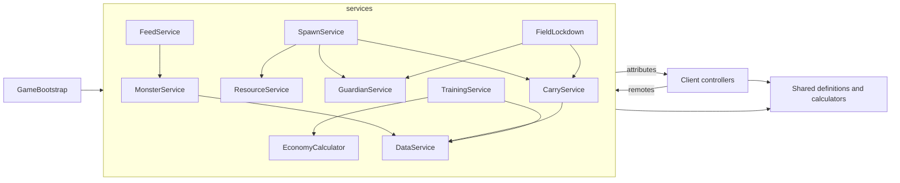

# Architecture and Module Map

## At a Glance

A small, data-driven, server-authoritative Luau codebase. Rojo owns code; Studio owns the world. One bootstrap script starts the services in a fixed order. Shared modules hold definitions and pure calculators. Clients render server-published state and send requests.

## Current Implementation

**VERIFIED IMPLEMENTATION** (2026-10-21).

### Rojo mapping (`default.project.json`, project name still `Feed a Dino`)

| Rojo path | Studio location |
| --- | --- |
| `src/shared` | `ReplicatedStorage.Shared` |
| `src/server` | `ServerScriptService.Server` |
| `src/client` | `StarterPlayer.StarterPlayerScripts.Client` |
| `tests/unit` | `ServerStorage.UnitTest` |
| `tests/UnitTestRunner.server.luau` | `ServerScriptService.UnitTestRunner`, `Disabled = true` |

Studio owns Workspace, bases, terrain, models, animations, lighting, packages. Code reads markers and does not rewrite the saved place.

### Lifecycle

`GameBootstrap.server.luau`: (1) `DefinitionValidation.config()` and an assert (five areas, 40 launch resources, pet references, trainer ladder, billboard config); (2) `DataService.start()`; (3) `MonsterService`, `CarryService`, `GuardianService`, `SpawnService`, `FeedService`, `TrainingService`, `BaseService` each `.start()`; (4) `DevTestService.start()` (Studio-only remote). Do not add a second startup script that also calls a service's `start`.

### Server services

| Module | Job |
| --- | --- |
| `DataService` | Load and save through `SessionStore`; 60 s autosave |
| `BaseService` | Assign one of four bases, start the player load, evacuate to base |
| `MonsterService` | Pet publish, evolution choice, multipliers |
| `CarryService` | One carried item, WalkSpeed, drop, forfeit, Slow Mode |
| `GuardianService` / `GuardianCatch` | Per-area hazard, pursuit, catch consequence |
| `SpawnService` / `ResourceService` | Pickup transaction, field state, reset clock |
| `FieldLockdown` | Reset closure, evacuation, gates |
| `FeedService` / `FeedRolls` | Preview, confirm, mutation rolls |
| `TrainingService` / `TrainerVisualService` | Train, stop, buy next tier, station model |
| `InteractionGuard` | Per-player rate limiting |
| `DevTestService` / `DevTestConfig` | Studio-only command remote |
| `ZoneGeometry`, `BiomeTerritory` | Read territory from Studio markers |
| `ResourceVisualService`, `BillboardMetadataService` | Runtime visuals and tags |

### Shared modules

Definitions: `AreaDefinitions`, `ResourceDefinitions`, `ResourceCatalog`, `MonsterDefinitions`, `GrowthStageDefinitions`, `TrainerDefinitions`, `RarityDefinitions`, `RarityStyles`, `FieldConfig`, `EconomyConfig`, `MovementConfig`, `GuardianConfig`, `PetProgressionConfig`, `MutationDefinitions`, `CatalystDefinitions`, `SpecialEffectDefinitions`, `BillboardConfig`, `FeedDefinitions`, `ModifierStyles`, `ResourceModelDefinitions`, `ResourceTypes`, `PlayerData`.
Pure calculators: `EvolutionCalculator`, `EconomyCalculator`, `MovementCalculator`, `CarryDebuff`, `FieldRoller`, `FieldState`, `RadialSpawn`, `BiomeLayout`, `GuardianChase`, `GuardianState`, `GuardianAim`, `GuardianGeometry`, `PetMultipliers`, `PetRarity`, `PrestigeCalculator`, `CatalystEffects`, `ResourceEffects`, `ResourceValidation`, `NumberFormat`, `DevTestProtocol`, `BillboardData`.

### Clients (`src/client`)

`UIController` (HUD `MonsterHud`), `CarryController` (G drop, V Slow Mode), `EffectsController`, `CarryCursePresentation`, `GuardianPresentation`, `FieldController` and `FieldPresentation`, `BillboardController`, `BillboardService`, `BillboardView`, `DevTestPanel`.

## Dependency Sketch

## Constraints and Invariants

- Calculators do not touch Roblox services or player state. `GuardianConfig.validate` is a stylistic exception (it requires other shared modules).
- `--!strict` is common; `GuardianConfig`, `GuardianState`, `MonsterDefinitions`, `MutationDefinitions`, `FieldLockdown` are `--!nonstrict`. Match the file you edit.
- Stable string ids; display names separate.
- **Legacy names** (`Feed a Dino`, `MonsterService`, `MonsterProgress_v1`, `MonsterHud`) are intentional leftovers. Do not rename them in a drive-by edit.
- Do not change the Rojo mapping, add remotes, or add DataStores without approval.

## Open Questions

Whether to rename legacy ids in a dedicated task. A Blender-to-Roblox pipeline is not defined ([[02 - Engineering/Tooling and Build]]).

## Related Notes and Source Files

[[02 - Engineering/Data, Networking and Persistence]], [[02 - Engineering/Security, Testing and Diagnostics]], `docs/CURRENT_STATE.md`.
