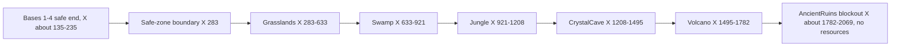

# World Layout and Zones

## At a Glance

Four compact bases at the safe end of one long path that runs along +X; five launch areas follow in risk order. The map is a runway, not an open world. Studio owns all of it; code reads markers. Dimensions below were read through Studio MCP from a live Play server on 2026-10-21 and are rounded to whole studs. Re-inspect before depending on them.

## Map Structure

**CONFIRMED DESIGN:** four bases, linear progression low to high risk, narrow social space, risk by distance, small biome pockets, exactly five launch areas, and an `AncientRuins` blockout that is **not** a sixth resource pool. After roughly 6 to 8 permanent areas the design favors branches and events over a longer road.

## Verified Scene Contract

| Studio path | Role |
| --- | --- |
| `Workspace.Bases.Base1` to `Base4` | Player plots. Base centers at X about 183, Z -239, -120, -9, 103; each about 72 x 34 x 100 |
| each base `NewBase` | `PlayerSpawn`, `CreatureSpawn`, `FeedingPoint` (with proximity prompt); `TrainingStation` is created at runtime (Base1: about X 229) |
| `Workspace.ExpeditionZones` | Folders `Grasslands`, `Swamp`, `Jungle`, `CrystalCave`, `Volcano`, `AncientRuins`; each launch folder has `ResourceNodes` with 5 nodes and three Parts (floor and two walls) |
| `Workspace.GeneratedGameplay` | Runtime `Guardians`, `Resources`, `FieldGates` (5), `Monsters`, and the `SafeZoneBoundary` part |
| `Workspace.Ground`, `Terrain`, `area.Border`, `Shops.*` | Studio-owned scenery and unknown-purpose models |

**Lane geometry (verified).** Each area floor is a 1-stud-thick Part about 157 studs wide (Z -164 to -7, centered Z -86). Floors are 350 studs long for Grasslands (X 283 to 633) and about 287 studs for the others. Two wall Parts about 41 studs high and 17 thick flank each floor at Z -173 and Z +1. The launch runway from the safe boundary to the Volcano end is about 1,500 studs. Resource nodes sit within Z -98 to -75 and these X ranges: Grasslands 349 to 567, Swamp 688 to 866, Jungle 975 to 1153, CrystalCave 1262 to 1440, Volcano 1549 to 1727. Guardians stand at X 458, 777, 1064, 1351, 1638 (Z about -99). Field gates sit at each floor's start (X 283, 634, 921, 1208, 1495).

**Radial pockets.** `BiomeLayout` places resources around the guardian home (radius 24 to 90, rear depth 24, separation 22, end margin 12). `docs/RADIAL_BIOME_LAYOUT_REPORT.md` escape counts predate the fast-heist speeds; do not reuse them.

**Lighting.** `Lighting.ClockTime` read 14.5 in Play. Reset presentation includes a night hook (`FieldPresentation`).

## Zones

All five share: status = functional graybox blockout, no final art. Resources and guardians come from `AreaDefinitions` ([[01 - Game Design/Rarity and Content Catalog]]). Props, landmarks, and per-zone lighting were **not inspected** (only floors, walls, nodes). Open question for every zone: approved environment kit.

### Grasslands

Purpose: onboarding and the vertical slice. Guardian T-Rex (Charge). Resources: RawMeat to PrimalCatalyst. Natural logic: carcass, berries, bones. Risk: lowest. Spawn: nearest the bases. Intended kit: grass clumps, rocks, bone piles, logs, small and large trees, a feeding-ground carcass, a sleeping spot. Reference (illustrative art, not a 3D map): ![[Attachments/World/sae-zone-art-forest.jpg|220]] REF-WK-102.

### Swamp

Guardian Giant Crocodile (Lunge). Resources: SmallFish to ToxicCatalyst; contains MutantLeech. Intended kit: mud rocks, dead tree, mushrooms, reeds, murky-water props, bones, logs. Reference: closest available is a lake illustration ![[Attachments/World/sae-zone-art-lake.jpg|220]] REF-WK-104 (no swamp reference exists).

### Jungle

Guardian Giant Gorilla (Shockwave, widest hazard). Resources: WildFruit to JungleHeart. Intended kit: broadleaf plants, vines, rocks, giant roots, tree pieces, flowers, logs. Reference: ![[Attachments/World/sae-zone-art-jungle.jpg|220]] REF-WK-103.

### Crystal Cave

Guardian Armored Triceratops (Charge, longest hazard). Resources: CrystalShard to CrystalCatalyst. Intended kit: crystals in several sizes, rock formations, fossil pieces, cave pillars, bone piles. Reference: no direct cave reference was inspected; an ice-field illustration is the nearest cool-palette stand-in ![[Attachments/World/sae-zone-art-snow.jpg|220]] REF-WK-106.

### Volcano

Guardian Dragon (FireSweep). Resources: CharredMeat to InfernoCatalyst, including Eternal and Divine. Highest risk and longest return. Intended kit: basalt, lava rocks, burned trees, bones, charred carcass, volcanic crystals, lava-edge props. Reference: ![[Attachments/World/sae-zone-art-volcano.jpg|220]] REF-WK-109.

### AncientRuins

Blockout only, excluded from `AreaDefinitions`, no nodes. Floor at X about 1926.

## Reference Observation

Steal an Egg uses many themed biomes along a lane; stills show brick-walled lanes with a pet-colored floor ![[Attachments/World/sae-zones-lane-overview.jpg|300]] REF-WK-094. Feed a Pet keeps one runway and five fixed areas. Coverage is incomplete: no reference exists for swamp or crystal cave, and no Feed a Pet 3D screenshot is stored.

## Constraints and Invariants

Never edit Studio-owned instances without an explicit request. Never invent instance paths; inspect with Studio MCP. Do not move saved nodes from code.

## Open Questions

Path length cap, per-zone environment kits, zone signage, final lighting ([[05 - Development/Decisions and Open Questions]]).

## Related Notes and Source Files

[[01 - Game Design/Resources and Field Resets]], [[01 - Game Design/Guardians and Carrying]], [[03 - Visual Design/Art Direction]].
